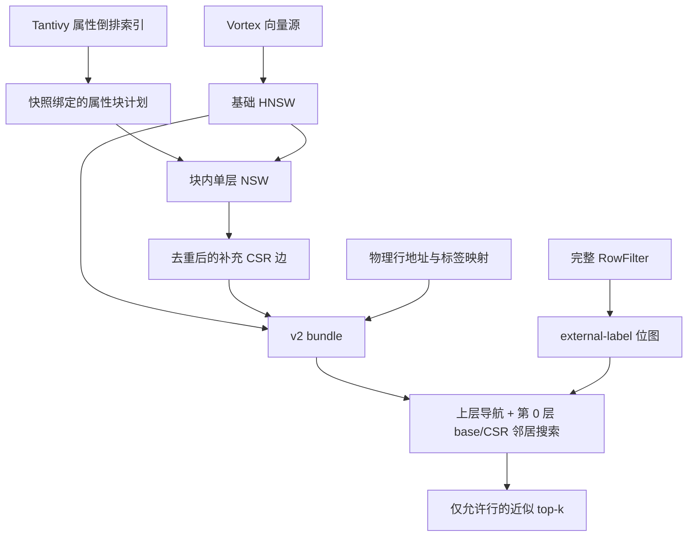

<!--
SPDX-FileCopyrightText: Copyright the Vortex contributors
SPDX-License-Identifier: CC-BY-4.0
-->

# Vortex filterable HNSW：实现设计与 roadmap

更新：2026-10-29。按最新要求直接增强现有 `hnswlib.static`，不实现 ACORN，不保留旧格式兼容分支，不提供自动扫描 fallback。旧 generation 必须重建。

## 1. 范围与基线

- Vortex 基于 `feat/vortex-index` 的 `ee085f55a705cb9b2edab18d392dd822540774d7`。
- 集成分支：`feat/vortex-filterable-hnsw`。多个 PR 均以此分支为目标，当前不自动合并。
- hnswlib 固定为 v0.9.0，commit `d9b3608c83d83b46c96e25088cb1d729b29dcfe9`。
- 参考 Qdrant `222b2e44ab1c3f17e8246396ead6558e45041df7` 的 [属性块建图](https://github.com/qdrant/qdrant/blob/222b2e44ab1c3f17e8246396ead6558e45041df7/lib/segment/src/index/hnsw_index/hnsw/build/additional_links/block.rs) 和 [块边合并](https://github.com/qdrant/qdrant/blob/222b2e44ab1c3f17e8246396ead6558e45041df7/lib/segment/src/index/hnsw_index/graph_layers_builder.rs)。

本批交付静态、不可变、非空 Float32 向量、squared-L2、Linux x86_64 AVX2/FMA/F16C。支持完整 RowFilter 的 allow/exclude 语义；不引入在线更新、量化、其他距离度量或 SQL 自动选择新算法。

`supports_filter=true`，`supports_exact=false`。SearchMode::Exact 明确报错。独立暴力检索仅作为测试和 benchmark 真值，不是运行时回退路径。

## 2. 架构与职责



| 组件 | 职责 |
| --- | --- |
| `vortex-index` | 属性块请求/计划契约、验证、RowFilter 的只读集合访问 |
| `vortex-fts` | 从 term dictionary 和 postings 枚举等值组、重叠数值窗口 |
| `native/hnswlib/payload_graph.h` | 块内建图、边合并、CSR 验证、过滤搜索算法 |
| `native/bridge.cpp` | 原生所有权、异常边界、位图适配、薄 FFI |
| `vortex-index-hnswlib` | 快照/coverage 校验、标签转换、预算、持久化、provider |

hnswlib 扩展头文件在 Vortex 仓库维护，直接使用固定上游的距离函数、内部 ID 和 visited-list pool。它不是上游 hnswlib 已发布的功能。本轮不创建另一套后端或外部 fork 仓库。

## 3. 属性块契约

`AttributeBlockRequest` 包括：字段到策略的有序映射、covered_files、min_rows、target_rows、max_block_rows、max_blocks、max_memberships。

- 字段独立分组；不枚举 AND/OR 条件的笛卡尔积。
- Equality：一个值的完整 posting list。支持 bool、精确字符串、i64、u64、有限 f64。
- NumericRange：按数值顺序组成约 target_rows 大小的窗口，再前进约 target_rows/2 行；相同值不拆分，因此实际重叠率和窗口大小受重复值影响。
- null 没有 posting。f64 沿用现有有限值与正负零归一化语义。
- 低于 min_rows 的块不建补边。超大等值组或窗口直接报错，不截断、不暗中抽样。
- 请求的文件必须由属性索引完整覆盖，并与向量索引处于同一 Snapshot。
- 构建处理物理行，不应用查询时的可见性或 tombstone；查询必须另行传入完整 RowFilter。

返回 `AttributeBlockPlan { snapshot, request, blocks }`，每块由 Eq/Range 谓词标识，行地址排序且唯一。消费端重新检查快照、请求、块身份、row coverage 和预算。

首版计划有界地保存在内存中。max_blocks 同时限制单字段 distinct terms 和总体输出块；max_memberships 分别限制总输入 posting 数与总输出成员数，重叠成员重复计数。若后续规模要求超过该上限，可单独改为流式接口，不能移除预算。

## 4. 建图与合并

1. 校验格式、覆盖行数、向量字节预算和属性索引绑定。
2. 枚举并验证属性块计划。
3. 按源扫描顺序分配 dense external label，保存 `label -> RowAddress`。
4. 构建并保存基础 HNSW；校验原生文件结构后打开冻结的基础图。
5. 将块内 RowAddress 转成 external label，再由原生 `label_lookup_` 转成 internal ID。
6. 块内按 internal ID 排序，借用基础图中的向量，构建真正的单层 NSW。
7. 对各节点合并块边，去重、删除已有基础图边，冻结成 CSR。
8. 写入私有 bundle，由现有 owner 执行 seal/publication。

不能用 upstream `addPoint(..., level=0)` 伪装单层图：该值仍会随机生成层级。扩展有独立的单层插入与邻居选择逻辑，复用相同的距离多样性启发式。

`payload_m` 限制每块新增点的前向邻居至 M、反向邻居至 2M；不是所有块合并后的总度数。重叠字段可能让总度数增长，因此还有 max_payload_degree 和 max_payload_edges。任何硬上限失败都废弃本次构建，不发布半成品。

基础图的层级、邻接和向量保持不变。补充边在搜索时逻辑上并入第 0 层，避免修改 hnswlib 固定容量的 level-zero 内存布局。构建只借用向量，不为每个块复制向量数据。

## 5. 查询行为

- 无限制 RowFilter 使用原有基础图搜索，不访问补边。
- 受限查询先验证 Snapshot、维度、有限数值、k、ef 和批量数量。
- provider 在打开时建立 `RowAddress -> external label` 反向映射。稀疏 allow/exclude 集合直接转换为标签位图；同一 Snapshot 中未被当前索引覆盖的行不会误映射。
- 批量查询只构建一次位图，所有查询先验证再执行。
- 空位图在输入验证后返回空结果；这是已知空集合，不是扫描 fallback。
- 上层导航不施加结果过滤；第 0 层访问 base 与 payload 邻居并共享 visited 标记。
- 被过滤节点可以用于导航，但只能把通过位图的标签放入结果堆。
- 少于 k 个匹配行时允许返回较少结果。ANN 不承诺任意 ef 都达到精确 top-k。
- 结果转换回 RowAddress 后按距离、行地址排序，检查 ID、距离和重复结果。

同一原生 handle 用 mutex 串行化 ef 修改和搜索；独立 generation 没有全局查询锁。扩展的 visited-list 租借使用 RAII，在异常时归还。

## 6. 格式 v2 与完整性

继续使用 backend ID `hnswlib.static`，`backend_version=2`、bundle `format_version=2`、build options `format_version=2`。不同时支持 v1。

固定四个 artifact：

| 文件 | 内容 |
| --- | --- |
| `hnswlib/bundle.json` | revision、shape、metric、snapshot、fields、coverage、其他三个 artifact 的内容摘要 |
| `hnswlib/index.bin` | 固定版本的基础 HNSW 与向量 |
| `hnswlib/rows.bin` | dense external label 对物理 RowAddress 的完整映射 |
| `hnswlib/payload.bin` | internal-ID CSR 补充边，关闭补边也必须存在 |

payload 编码为 little endian：8 字节 magic `VXHNPL02`、u64 rows、u64 edges、rows+1 个 u64 offset、edges 个 u32 neighbor。

打开流程：完整 inventory/大小检查 → 私有 lease 校验内容摘要 → descriptor 与 metadata/摘要绑定检查 → row mapping 与 CSR 完整验证 → 基础图结构检查 → 原生加载。

CSR 必须 offset 起始为 0、单调、终点等于边数、文件长度精确匹配；邻居在范围内、无自环、每行严格递增，且符合 edge/degree 上限。截断、尾随数据、换配图/行映射、丢失 payload 和旧格式都报错。

沿用现有 store 的内容摘要，不再增加另一份重复 digest header。首版不持久化完整含行列表的 block plan；边与基础图、行映射通过 descriptor 的三个摘要绑定。构建参数和实际块统计的长期审计文件可在后续诊断工作中增加，不影响读取语义。

## 7. 配置与资源

示例 build JSON：

```json
{
  "format_version": 2,
  "dimension": 128,
  "m": 16,
  "ef_construction": 128,
  "seed": 100,
  "threads": 1,
  "payload_m": 8,
  "payload_fields": {"category": "equality", "price": "numeric_range"},
  "payload_min_rows": 2,
  "payload_target_rows": 4096
}
```

builder 必须显式 `with_attributes(opened_attribute_index)`。`payload_m=0` 与空 payload_fields 一起表示不构造补边，仍生成合法空 CSR 并支持位图过滤。

| 默认上限 | 值 |
| --- | --- |
| 覆盖行数 | 1,000,000 |
| 缓冲向量字节 | 512 MiB |
| 基础图与 payload artifact 合计 | 1 GiB |
| 补充有向边 | 32,000,000 |
| 每节点补充度数 | 256 |
| 单块行数 | 100,000 |
| 输入 posting / 输出 membership | 各 8,000,000 |
| distinct terms / 总块数 | 65,536 |

这些是对象与工作量预算，不是进程 RSS 配额。计划、原生块邻接、合并边、序列化缓冲可能暂时共存。CSR 常驻大小约 `8*(N+1)+4*E`；标签位图约 `N/8` 字节，另有物理行映射和反向映射。

## 8. 验证

- 原生不变量：块内边、不重复、无自环、无跨块新边、基础图字节不变、非 identity label、预算报错。
- 搜索：payload-only 路径、被过滤导航节点、空/单点集合、复合条件、排除优先、批量一致、独立暴力真值。
- 持久化：build/seal/reopen、snapshot mismatch、缺失/损坏 CSR、artifact 换配、旧版本拒绝。
- 并发：同 handle 不同 ef、独立 build/open、受限查询，保持 stateless 距离内核。
- 检查：受影响 crate tests/doctests、Clippy、Rust/C++ 格式、workflow YAML、ASan/UBSan/LSan 与现有 TSan 流程。

已固定上游的 SSE construction prefetch 在 `hnswalg.h:277` 有邻居越界读，原生 sanitizer fixture 使用 upstream scalar 路径隔离该既有问题；另跑 AVX2 功能测试。扩展代码没有 sanitizer suppression。此项不能表述为全部生产 SIMD 路径已通过 ASan。

## 9. Roadmap 与 PR

| 阶段 | 交付 | 验收 |
| --- | --- | --- |
| P1 原生算法 | 块内单层图、合并 CSR、过滤搜索、原生测试 | 图不变量、真值校验、sanitizer |
| P2 属性分块 | 通用计划契约、Tantivy 等值与数值窗口 | 与精确谓词逐块对照、coverage 与预算 |
| P3 Provider 接入 | 位图、FFI、v2 artifact、builder、重新打开、端到端测试 | 构建查询闭环、损坏拒绝、并发与全部受影响检查 |
| P4 工作负载性能资格 | 随机/相关/反相关属性，倾斜分布，复合条件，真实业务数据 | recall@k、p50/p95/p99、build time、RSS、artifact bytes；对照同参数原生过滤基线 |
| P5 扩展与运维 | 按测量结果调整分块/预算、必要时流式计划、诊断统计 | 证明收益、维持硬上限与查询语义 |

本批提交 P1–P3。P4 的代表性业务数据与生产阈值不是小型正确性 fixture 能代替的，不能据此宣布生产性能资格通过。ACORN 不属于这些阶段。

- [PR #29：原生算法](https://github.com/AstroVela/vortex/pull/29)
- [PR #30：属性分块](https://github.com/AstroVela/vortex/pull/30)
- Provider PR 依赖前两项，统一目标为 `feat/vortex-filterable-hnsw`；合入前按实际 base 更新依赖 diff。
